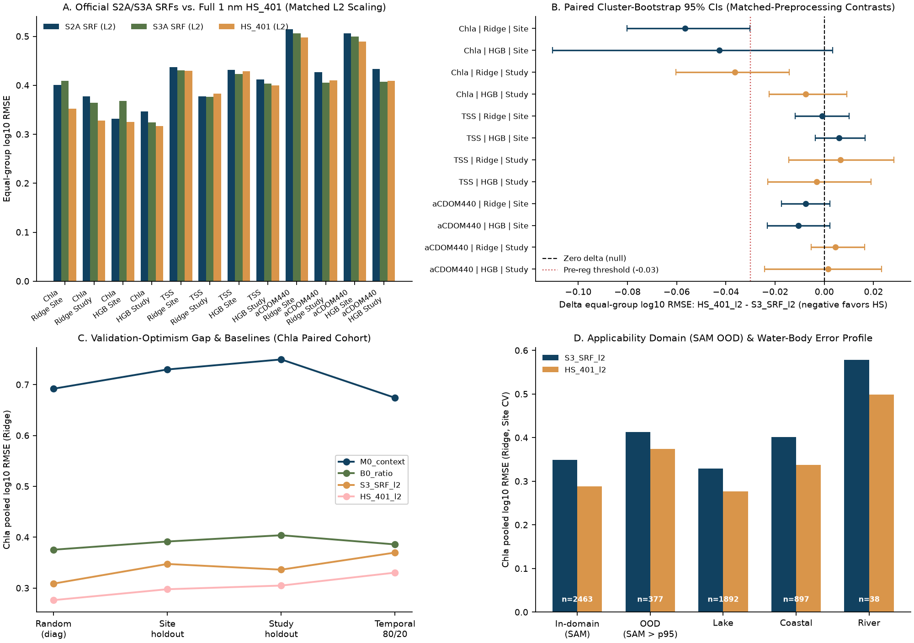

# HS-R02: Official ESA SRF Compression vs. Full 1 nm Hyperspectral Retrieval on GLORIA

- **Experiment ID:** `HS-R02` (canonical; paired with `GL-R08`)
- **Pre-registration:** [`pre-registrations/2026-11-26-hs-r02-official-srf-retrieval.md`](../../pre-registrations/2026-11-26-hs-r02-official-srf-retrieval.md) (frozen `2026-11-26`, `A01`–`A10` & matched-L2 refinement frozen `2026-11-28` prior to full execution)
- **Evidence status:** **`exploratory`** (author-run with complete deterministic provenance in [`manifest.json`](manifest.json), `git_tree_clean: true`, `script_in_commit: true`; not yet independently reproduced by a third party)

## Scientific verdict (§5 pre-registered decision rule)

**Outcome: Bounded / null standalone hyperspectral advantage under matched preprocessing (`Boring / null` — scientifically informative).**

Across all three targets (`Chla`, `TSS`, `aCDOM440`) and both primary holdout regimes (`Country|Site_name` waterbody-held-out and `Dataset_ID` study-held-out 5-fold CV), **zero `(target, estimator)` cells meet the full §5 "Interesting" threshold** (`delta <= -0.03` log10 RMSE vs. **both** matched-preprocessing `S3_SRF_l2` and `B0_ratio` on **both** site and study holdouts with 95% cluster-bootstrap CIs strictly `< 0`):

1. **Preprocessing dominates spectral resolution.** Applying unit-L2 spectral-shape normalization plus `log10(||Rrs||_2)` cuts linear `Ridge` equal-group `log10` RMSE by **`0.09–0.22` log10 units** across `primary_optical` site and study holdouts (`0.087–0.128` on `TSS`, `0.120–0.165` on `aCDOM440`, `0.177–0.216` on `Chla`)—`3.3–4.9×` larger than the matched-L2 hyperspectral delta on `Chla` `Ridge` and `> 15×` larger on `TSS` and `aCDOM440`. Comparing L2-normalized `HS_401_l2` against raw un-normalized `S3_SRF` creates an illusory "hyperspectral gain" (`-0.09` to `-0.24` log10 RMSE in `Ridge`; `-0.031` to `-0.042` in `Chla` `HGB`) that collapses once `S3_SRF` receives identical L2 normalization (`S3_SRF_l2`).
2. **Chlorophyll-a (`Chla`, `n = 2,840` primary / `2,764` paired):**
   - Under linear **`Ridge`**, `HS_401_l2` genuinely beats matched `S3_SRF_l2` on both site (`-0.0567`, 95% CI `[-0.0802, -0.0302]`, Holm $p = 0.006$, family size $m = 6$) and study holdouts (`-0.0364`, `[-0.0603, -0.0142]`, Holm $p = 0.006$, $m = 6$), and this gain persists after controlling for geography and season (`M0_plus_HS` vs. `M0_plus_S3_l2`: `-0.0525` site, `-0.0407` study, both Holm $p = 0.003$, `Ridge`-only family $m = 3$). However, linear `HS_401_l2` (`0.3865`) is statistically indistinguishable from the two-feature physical baseline `B0_ratio` (`log10(Rrs(705)/Rrs(665))` + `AVW`, `0.3906`; delta `-0.0041 [-0.1029, +0.1401]`) on site holdout while outperforming `B0_ratio` on study holdout (`-0.0754 [-0.1260, -0.0266]`).
   - Under nonlinear **`HistGradientBoostingRegressor` (`HGB`)**, matched-preprocessing `HS_401_l2` vs. `S3_SRF_l2` 95% cluster-bootstrap CIs **span zero on both splits** (`-0.0426 [-0.1105, +0.0033]` site; `-0.0076 [-0.0224, +0.0092]` study), and 7-band `S2_SRF_l2` (`0.3315` site) nearly matches 401-band `HS_401_l2` (`0.3256`).
3. **Total suspended solids (`TSS`, `n = 3,038` primary / `2,982` paired):** Clean null across both estimators and both holdouts (`HS_401_l2` vs. `S3_SRF_l2`: **`-0.0031` to `+0.0066`** log10 RMSE, all 95% CIs spanning zero), consistent with broadband particulate scattering lying inside the 4–7 PC spectral manifold identified in EDA.
4. **CDOM absorption (`aCDOM440`, `n = 2,709` primary / `2,644` paired):** Clean null for `HS_401_l2` over 15-band `S3_SRF_l2` (`-0.0106` to `+0.0045` log10 RMSE, all 95% CIs spanning zero). Compared against 7-band S2A MSI (`S2_SRF_l2`, shortest band `B1` at 443 nm), S3A OLCI (`S3_SRF_l2`, adding 412 nm `Oa02`) reduces equal-group `log10` RMSE by **`0.007–0.009` on site holdout** (`-0.0091 [-0.0183, -0.0006]` `Ridge`; `-0.0068 [-0.0203, +0.0068]` `HGB`) and **`0.022–0.026` on study holdout** (`-0.0218 [-0.0318, -0.0129]` `Ridge`; `-0.0259 [-0.0427, -0.0115]` `HGB`, both Holm $p = 0.006$).

## Radiometric error budgets & applicability-domain findings

- **Official ESA SRF vs. rectangular boxcar (`radiometric_budget.csv`):** Despite band-level p95 $R_{rs}$ discrepancies reaching `5.7%` (`B6`) and `22.6%` (`Oa13`), within-sensor retrieval RMSE shifts stay within **`|delta| <= 0.0051` log10 units** across all 24 `(target, split, estimator, sensor)` cells (largest `|delta| = 0.005046` on `Chla` study `HGB` S3A OLCI; every `HGB` 95% CI spans zero). Supervised models absorb systematic within-sensor bandpass offsets during training, though official SRFs remain necessary for cross-sensor transfer and physical forward modeling.
- **Negative $R_{rs}$ retention:** Retaining the `308` (`Chla`), `31` (`TSS`), and `264` (`aCDOM440`) unclipped negative-$R_{rs}$ spectra (with `87.7%` of negative `Chla` and `87.9%` of negative `aCDOM440` spectra negative only in `701–800 nm`) shifts raw-reflectance `Ridge` by up to `0.056` log10 RMSE on `aCDOM440`, while L2-normalized `HS_401_l2` is nearly invariant (`|delta| <= 0.001` on `aCDOM440`, `0.002–0.015` on `TSS`, `0.007–0.020` on `Chla`).
- **`A10` `400–700 nm` Lake Geneva (`OdermattD_CH_Eawag`) optical-circularity stress test:** All `290` `OdermattD_CH_Eawag` rows end at `700 nm` (`0` enter `400–800 nm`; `+286` enter `400–700 nm`, `3,455` excluded vs. `3,741` included). Retaining those optically inferred targets lowers `S2_SRF_400_700` equal-group `log10` RMSE by `0.011–0.013` under `Ridge` (`0.005–0.007` under `HGB`) and lowers `HS_301_l2` `Ridge` study-holdout RMSE by `0.010` (while shifting `HS_301_l2` `Ridge` site RMSE by `+0.014` and `S3_SRF_400_700` `Ridge` study RMSE by `+0.031` via fold redistribution), confirming that isolating optically derived targets is required whenever `400–700 nm` benchmarks are run.
- **Applicability domain (SAM OOD) & severe riverine gap (`ood_and_waterbody_stratified.csv`):** For `HS_401_l2`, spectra exceeding the training p95 nearest-neighbor SAM threshold incur **`+0.024` to `+0.142` higher pooled `log10` RMSE on `site_kfold`** (`+0.096` to `+0.257` on `dataset_kfold`) across all targets and both estimators. On `site_kfold` (`HS_401_l2`), riverine error is severe (`Chla` rivers `n = 38`: `MdSA = 123%` `Ridge` / `237%` `HGB` vs. `45–47%` in Lakes `n = 1,892`; `aCDOM440` rivers `n = 162`: `MdSA = 154–168%` vs. `51–60%` in Lakes), reinforcing why standalone 1 nm reflectance without OWT stratification, derivative/unmixing physics, or tropical river coverage remains bounded.

## Retained files

| File | Contents |
| --- | --- |
| [`run_hs_r02.py`](run_hs_r02.py) | Deterministic benchmark runner (`Ridge` 5-fold inner CV; `HGB` 3-fold inner CV, 16-config grid) |
| [`manifest.json`](manifest.json) | Byte-deterministic provenance record (`CohortCounts`, verified input/output SHA-256s, decision summary) |
| [`metrics.csv`](metrics.csv) | All `(target, cohort_mode, split, estimator, arm)` regression metrics including `raw_mdsa` |
| [`paired_deltas.csv`](paired_deltas.csv) | 2,000-draw whole-group cluster bootstrap deltas (`RMSE(candidate) - RMSE(ref)`) & Holm-Bonferroni $p$ |
| [`radiometric_budget.csv`](radiometric_budget.csv) | Official SRF vs. boxcar, negative-$R_{rs}$ retention, and `A10` `400–700 nm` circularity sensitivities |
| [`ood_and_waterbody_stratified.csv`](ood_and_waterbody_stratified.csv) | Per-fold SAM OOD (`in_domain` vs. `ood`) and `Water_body_type` stratified error profiles |
| [`hs_r02_summary_figure.png`](hs_r02_summary_figure.png) | 4-panel Crameri `batlow` summary of matched-L2 retrieval accuracy, bootstrap CIs, split optimism, and OOD/river errors |
