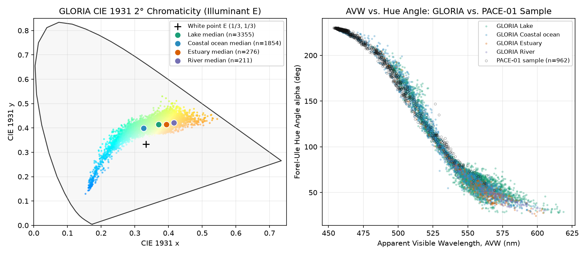
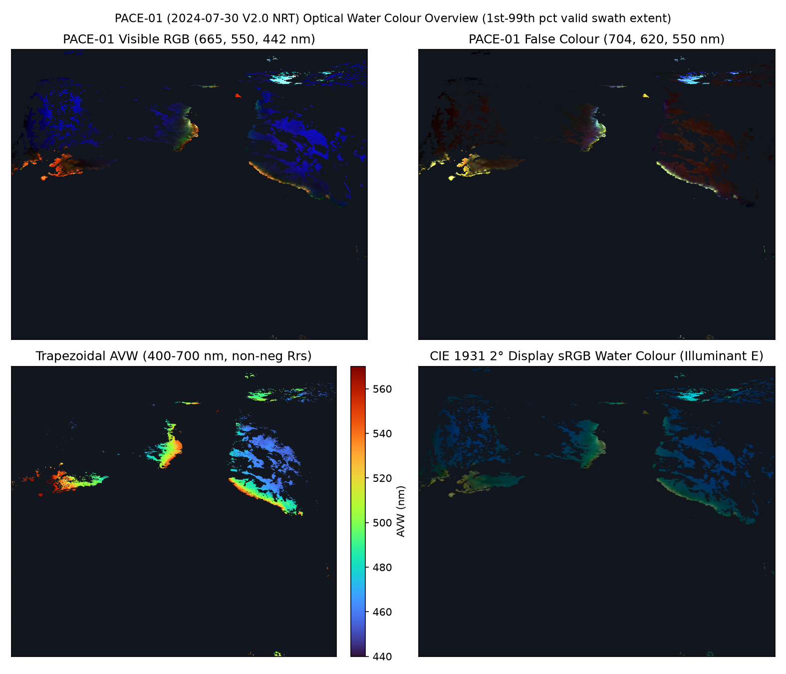

# Q01 — Water Colour, Chromaticity & Exploratory OWT Screening (`exploratory`)

- **Evidence status:** `exploratory` (author-executed from locally verified archives; not yet independently rerun by a second person).
- **Driving question:** *Why do different bodies of water have different colours, and where does a clear-ocean satellite swath sit relative to an in situ inland/coastal hyperspectral library?*
- **Reproducing script:** [`notebooks/Q01_water_colour_and_owts.ipynb`](../../notebooks/Q01_water_colour_and_owts.ipynb)
- **Provenance record:** [`manifest.json`](manifest.json) (byte-deterministic across repeated executions; no wall-clock timestamps; validated via `hydrospectral.provenance.validate_manifest`).

## Retained files

| File | Description |
| --- | --- |
| [`manifest.json`](manifest.json) | Deterministic provenance record (`git_commit`, script/input/CSV SHA-256s, denominators, units, runtime) |
| [`gloria_color_by_water_body_type.csv`](gloria_color_by_water_body_type.csv) | GLORIA CIE 1931 2° chromaticity, Forel–Ule hue angle, AVW, and QWIP summaries by `Water_body_type` |
| [`gloria_color_by_water_type.csv`](gloria_color_by_water_type.csv) | GLORIA colour and AVW summaries by investigator-annotated `Water_type` (1–6 plus unassigned) |
| [`pace_swath_summary.csv`](pace_swath_summary.csv) | PACE-01 granule pixel accounting, PCA variance ratios, AVW/hue quantiles, and SAM OOD rates |
| [`owt_archetype_summary.csv`](owt_archetype_summary.csv) | Exploratory 4-quartile GLORIA AVW archetypes applied to sampled PACE-01 pixels (with SAM angle & spectral area) |
| [`fig01_gloria_chromaticity_and_avw.png`](fig01_gloria_chromaticity_and_avw.png) | GLORIA CIE 1931 2° chromaticity diagram (Illuminant E) and AVW vs. Forel–Ule hue angle with PACE-01 overlay |
| [`fig02_pace01_optical_overview.png`](fig02_pace01_optical_overview.png) | PACE-01 visible RGB, false-colour red-edge RGB, trapezoidal AVW, and CIE 1931 display sRGB panels |

## Key exploratory observations

1. **Physical colour gradient across GLORIA water-body types (`n = 5,719` unflagged complete 400–700 nm spectra of `7,572`):**
   - Optical water colour shifts monotonically from bluer **Coastal ocean** (`n = 1,854`, median AVW `532.9 nm`, median hue `95.5°`) to greener **Lakes** (`n = 3,355`, `550.9 nm`, `67.2°`), **Estuaries** (`n = 276`, `559.4 nm`, `54.2°`), and browner/sediment- and CDOM-rich **Rivers** (`n = 211`, `568.6 nm`, `48.5°`).
   - Across GLORIA's own `Water_type` labels, **Clear** waters (`n = 554`, median AVW `514.2 nm`, hue `149.3°`) separate cleanly from **Chl-dominated** (`555.3 nm`, `64.4°`), **Sediment-dominated** (`549.1 nm`, `62.5°`), and **CDOM-dominated** (`565.0 nm`, `48.6°`) waters, though Chl- and sediment-dominated waters overlap substantially in bulk hue angle — illustrating that scalar colour metrics cannot uniquely separate optically active constituents.
   - `47 / 5,719` unflagged GLORIA spectra retain at least one negative $R_{rs}$ band in 400–700 nm (preserved unclipped for QC diagnostics, yielding `n = 5,672` strictly non-negative AVW spectra).
2. **Negative-reflectance atmospheric-correction residuals on PACE-01 (`2024-07-30`, V2.0 NRT):**
   - Out of `2,175,120` swath pixels, `129,764` pass default NASA `l2_flags` exclusion and finite 400–719 nm screening. Swath PCA captures `99.59%` of variance in the first three components (`77.87%`, `18.96%`, `2.75%`).
   - **`67,162 / 129,764` (`51.8%`) of valid PACE-01 pixels contain at least one negative $R_{rs}$ band in 400–700 nm** (characteristic of atmospheric-correction over-subtraction in clear low-radiance open ocean). Strict non-negative trapezoidal AVW therefore evaluates on `62,602` pixels (median `486.1 nm`, IQR `461.8–508.7 nm`), whereas unclipped trapezoidal AVW evaluates on `129,558` pixels (median `468.3 nm`, reflecting inclusion of bluer clear-ocean pixels with slightly negative red reflectance). Preserving negative $R_{rs}$ exposes this selection bias explicitly rather than hiding it via zero-clipping.
3. **Domain gap between GLORIA and PACE-01 open ocean (`SAM OOD`):**
   - Using site-aggregated GLORIA medians (`440` unique `Country|Site_name` sites) so same-site replicates do not compress internal nearest-neighbour distances, the 95th-percentile leave-one-out SAM threshold is `0.0979 rad` (`5.6°`).
   - Against that threshold, **`1,361 / 2,000` (`68.05%`)** of sampled PACE-01 pixels are flagged out-of-distribution relative to GLORIA site medians, and **`1,962 / 2,000` (`98.1%`)** are left `unclassified_ood` against the four coarse GLORIA AVW-quartile archetypes (`Q1`–`Q4`, whose bluest quartile still spans `456.4–524.2 nm`). This reflects GLORIA's skew toward inland and turbid coastal waters versus PACE-01's clear Gulf/Caribbean open-ocean swath (median hue `219.3°`, CIE `x = 0.177, y = 0.203`).

## Caveats & what this package does NOT prove

- **Exploratory archetypes, not published OWT standards:** The four AVW-quartile archetypes are simple GLORIA summary prototypes, not published Spyrakos et al. (2018) 13-type or Bi & Hieronymi (2024) 10-type OWT libraries (tracked separately under `OPT-04` / `OPT-15` / `OPT-16`).
- **Linear band-center interpolation, not official SRF convolution:** Aligning GLORIA 1 nm spectra onto PACE OCI 400–700 nm band centers via `np.interp` is an exploratory approximation, not an official PACE OCI spectral response function convolution.
- **V2.0 NRT granule:** `PACE_OCI.20240730T181157.L2.OC_AOP.V2_0.NRT.nc` is a near-real-time educational granule rather than final science reprocessing.
- **No constituent or ecological claim:** Perceived water colour, AVW, and SAM optical classes reflect mixtures of pigments, CDOM, mineral sediment, and pure water; they do not identify microbial taxa or validate biogeochemical retrievals.

